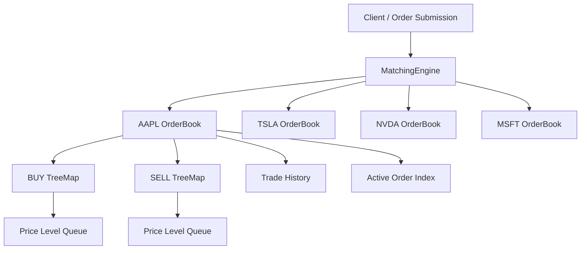

# Stock Exchange Matching Engine

A high-performance stock exchange matching engine built in Java that simulates
a continuous limit order book using price-time priority.

The engine supports multiple stock symbols, partial fills, order cancellation,
aggregated market depth, globally unique order IDs, thread-safe order processing,
and automated testing.

## Features

- Limit BUY and SELL orders
- Price-time priority matching
- FIFO ordering at the same price level
- Resting-order execution pricing
- Partial fills
- Multiple fills
- Order cancellation
- Order lifecycle tracking
    - NEW
    - PARTIALLY_FILLED
    - FILLED
    - CANCELLED
- Multiple independent stock symbols
- Globally unique order IDs
- Aggregated order book depth
- Integer-based price representation using cents
- Per-symbol synchronization for thread-safe order processing
- Concurrent order submission
- Automated JUnit testing
- End-to-end performance benchmarking

---

## Technologies

- Java 22
- Maven
- JUnit 5
- Java Collections Framework
    - TreeMap
    - ArrayDeque
    - HashMap
    - ConcurrentHashMap
- Java Concurrency
    - synchronized
    - ExecutorService
    - CountDownLatch
- IntelliJ IDEA
- Git / GitHub

---

## Architecture



The `MatchingEngine` manages a collection of independent `OrderBook` instances.

Each symbol has its own order book and synchronization boundary, allowing
different symbols to be processed independently.

## Matching Rules

The engine uses **price-time priority**.

### Price Priority

For BUY orders:

```text
Higher price = higher priority
```

For SELL orders:

```text
Lower price = higher priority
```

### Time Priority

Orders at the same price level are processed FIFO.

```text
SELL #1 @ $185
SELL #2 @ $185
SELL #3 @ $185

Execution:
#1 -> #2 -> #3
```

## Resting Order Pricing

Trades execute at the price of the order already resting in the order book.

Example:

```text
Resting:
BUY 100 AAPL @ $190.00

Incoming:
SELL 40 AAPL @ $185.00

Trade:
40 shares @ $190.00
```

## Partial Fills

```text
BUY 100 @ $190
SELL 40 @ $185
```

Result:

```text
Trade: 40 shares

BUY:
60 remaining
Status: PARTIALLY_FILLED

SELL:
0 remaining
Status: FILLED
```

## Order Book Depth

Orders at the same price level are aggregated.

```text
AAPL ORDER BOOK

SELL
$190.00  100
$191.00   50

----------------

$189.00   80
$188.00  120
BUY
```

## Price Representation

Prices are stored as integer cents.

```text
$185.00 -> 18500
$184.50 -> 18450
$0.01   -> 1
```

This avoids floating-point precision problems during price comparison.

## Concurrency

The engine supports concurrent order submission.

`MatchingEngine` uses concurrent collections for global engine state, while each
`OrderBook` synchronizes access to its own mutable state.

```text
AAPL -> AAPL OrderBook Lock
TSLA -> TSLA OrderBook Lock
NVDA -> NVDA OrderBook Lock
MSFT -> MSFT OrderBook Lock
```

Concurrency tests use:

- ExecutorService
- CountDownLatch
- Multiple worker threads

## Automated Tests

The project currently includes **17 JUnit tests** covering:

- Basic order matching
- Price priority
- FIFO / time priority
- Partial fills
- Multiple fills
- Order cancellation
- Duplicate active order IDs
- Globally unique order IDs
- Resting-order pricing
- Multiple symbols
- Order book depth aggregation
- Concurrent orders for the same symbol
- Concurrent orders across multiple symbols

Run the tests with:

```bash
mvn test
```

## Performance Benchmark

The benchmark submits generated orders across:

```text
AAPL
TSLA
NVDA
MSFT
```

The benchmark uses:

- Fixed random seed
- 100,000-order JVM warm-up
- 5 measured runs
- `System.nanoTime()`

| Orders | Average Time | Avg. Throughput | Avg. Time / Order | Avg. Trades |
|---:|---:|---:|---:|---:|
| 10,000 | 10.66 ms | 1,100,263 orders/sec | 1.066 µs | 7,580 |
| 50,000 | 38.82 ms | 1,343,716 orders/sec | 0.776 µs | 38,930 |
| 100,000 | 75.85 ms | 1,338,146 orders/sec | 0.759 µs | 77,468 |
| 500,000 | 290.82 ms | 1,734,488 orders/sec | 0.582 µs | 387,772 |

On the local test environment, the engine processed **500,000 simulated orders
in approximately 291 ms on average**.

> These are local application-level benchmark results and are not production
> performance guarantees.

## Project Structure

```text
src
├── main
│   └── java
│       └── com.ryozaki52.matching
│           ├── Main.java
│           ├── MatchingEngine.java
│           ├── Order.java
│           ├── OrderBook.java
│           ├── OrderSide.java
│           ├── OrderStatus.java
│           ├── PerformanceBenchmark.java
│           ├── PriceLevel.java
│           └── Trade.java
│
└── test
    └── java
        └── com.ryozaki52.matching
            ├── MatchingEngineTest.java
            └── OrderBookTest.java
```

## Example Usage

```java
MatchingEngine engine = new MatchingEngine();

Order buyOrder = new Order(
        1,
        "AAPL",
        OrderSide.BUY,
        19000,
        100
);

Order sellOrder = new Order(
        2,
        "AAPL",
        OrderSide.SELL,
        18500,
        40
);

engine.submitOrder(buyOrder);

List<Trade> trades =
        engine.submitOrder(sellOrder);

for (Trade trade : trades) {
    System.out.println(
            "Executed "
                    + trade.getQuantity()
                    + " shares at $"
                    + trade.getPriceAsDollars()
    );
}
```

## Future Improvements

- Market orders
- Modify / replace orders
- Stop orders
- Trade event listeners
- Persistent event logging
- JMH benchmarking
- Network/API interface
- Replayable order event streams

## What I Learned

This project provided hands-on experience with:

- Matching algorithms
- Ordered financial data structures
- Price-time priority
- FIFO queues
- Partial-fill logic
- Integer-based monetary representation
- Thread safety
- Concurrent collections
- Automated testing
- Performance measurement